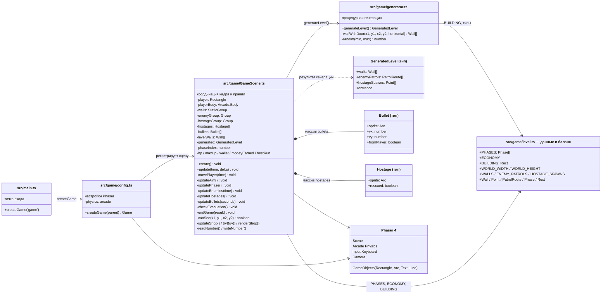

# Архитектура игры ron

Схема классов и связей. Игра — одна сцена Phaser ([`GameScene`](../src/game/GameScene.ts)),
которая координирует модули: данные уровня, процедурный генератор планировки
и сущности (игрок, враги, заложники, пули).

## Поток одного кадра

1. `GameScene.update()` — если магазин открыт, обрабатывает только покупки;
   если игра окончена — только рестарт по `R`.
2. `movePlayer()` — WASD задаёт скорость тела игрока; пробел стреляет по прицелу.
3. `updateAim()` — прицел: стрелки или курсор, рисуется линией `aimLine`.
4. `updatePhase()` — переход между фазами из `PHASES` по числу спасённых заложников;
   вход в фазу усиливает врагов и добавляет подкрепление.
5. `updateEnemies()` — патрули, агрессия и стрельба по игроку (с проверкой прямой
   видимости через `canSee()`); параметры берутся из текущей фазы.
6. `updateHostages()` — спасённые заложники следуют за игроком.
7. `updateBullets()` — движение пуль, попадания в стены/врагов/игрока, награды.
8. `checkEvacuation()` — заложники в зоне эвакуации засчитываются; все спасены — победа.

## Данные между сессиями

- `localStorage` ключи `ron.wallet` (кошелёк) и `ron.bestRun` (рекорд миссии) —
  читаются и пишутся в `GameScene` через `readNumber()` / `writeNumber()`.
- Всё остальное состояние (планировка, враги, заложники, HP) создаётся заново
  в `create()` при каждом запуске сцены.
